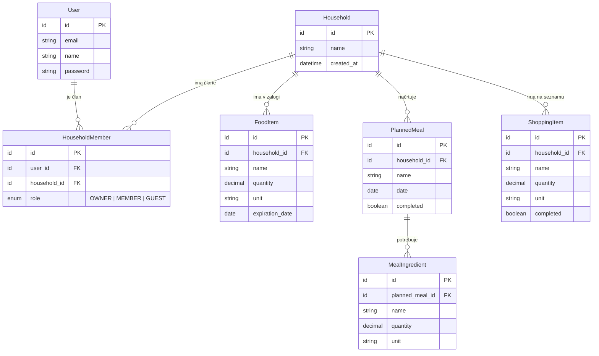

# Podatkovni model

Podatkovni model temelji na uporabnikih, gospodinjstvih, živilih, načrtih obrokov in nakupovalnih seznamih. Glavni podatki se hranijo v relacijski podatkovni bazi PostgreSQL.

## Entitete

### User

Predstavlja uporabnika aplikacije.

- `id`
- `email`
- `name`
- `password`

### Household

Predstavlja gospodinjstvo, ki si deli podatke.

- `id`
- `name`
- `created_at`

### HouseholdMember

Povezuje uporabnika z gospodinjstvom in določa njegovo vlogo.

- `id`
- `user_id`
- `household_id`
- `role` – `OWNER`, `MEMBER` ali `GUEST`

### FoodItem

Predstavlja živilo v zalogi gospodinjstva.

- `id`
- `household_id`
- `name`
- `quantity`
- `unit`
- `expiration_date`

### PlannedMeal

Predstavlja posamezen obrok, načrtovan za določen dan. Načrt obrokov gospodinjstva so vsi njegovi načrtovani obroki, ki se prikažejo po datumih.

- `id`
- `household_id`
- `name`
- `date`
- `completed`

### MealIngredient

Predstavlja sestavino, ki je potrebna za posamezen načrtovan obrok.

- `id`
- `planned_meal_id`
- `name`
- `quantity`
- `unit`

### ShoppingItem

Predstavlja živilo na nakupovalnem seznamu.

- `id`
- `household_id`
- `name`
- `quantity`
- `unit`
- `completed`

## Povezave med entitetami

- `User` je povezan z `Household` prek `HouseholdMember`.
- `Household` ima več `FoodItem` zapisov.
- `Household` ima več `PlannedMeal` zapisov.
- `PlannedMeal` vsebuje več `MealIngredient` zapisov.
- `Household` ima več `ShoppingItem` zapisov.

## ER diagram

