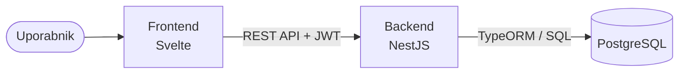

# Arhitektura in tehnološki sklad

## Arhitektura

### Glavni deli sistema

- **Frontend** – spletni vmesnik v Svelte.
- **Backend** – REST API v NestJS s poslovno logiko.
- **Podatkovna baza** – PostgreSQL.

### Komunikacija

Frontend komunicira z backendom prek REST API-ja. Do baze dostopa samo backend.

### Podatkovna baza

PostgreSQL. Backend do baze dostopa prek ORM-ja **TypeORM**, ki skrbi tudi za migracije sheme. Model je opisan v [03-podatkovni-model.md](03-podatkovni-model.md).

### Avtentikacija

Prijava z e-pošto in geslom (geslo shranjeno kot bcrypt hash). Backend ob prijavi izda **JWT token**, ki ga frontend pošilja pri vsaki zahtevi. Backend preveri token in vlogo uporabnika v gospodinjstvu (`OWNER`, `MEMBER`, `GUEST`).

### Lokalni zagon

Vse tri dele zažene Docker Compose:

```bash
docker compose up
```

### Diagram



## Tehnološki sklad

### Frontend

- **Svelte** s **SvelteKit**
- **TypeScript**
- **Vite** (razvojni strežnik in gradnja)
- HTML / CSS

### Backend

- **Node.js**
- **NestJS**
- **TypeScript**
- **Swagger / OpenAPI** (`@nestjs/swagger`) za dokumentacijo API-ja

### Podatkovna baza

- **PostgreSQL**
- **TypeORM** (`@nestjs/typeorm`) za dostop do baze in migracije

### Avtentikacija

- **JWT**
- **Passport** (`@nestjs/passport`, `passport-jwt`)
- **bcrypt** za hashiranje gesel

### Lokalni razvoj

- **Docker** in **Docker Compose**
- **Git** in **GitHub**
- **ESLint** in **Prettier** za enoten slog kode

### Testiranje

- **Playwright** za end-to-end teste uporabniških tokov v brskalniku (npr. dodajanje živil v zalogo, načrtovanje obrokov, nakupovalni seznam)
- **Playwright** (`request` API) za teste REST API končnih točk, vključno s poslovno logiko (npr. izračun manjkajočih sestavin, odštevanje porabe)

## Arhitekturne odločitve

### Svelte (SvelteKit) za frontend

Svelte ima preprost komponentni model in malo dodatne kode, kar pospeši razvoj. Aplikacija ima več interaktivnih pogledov (zaloga, načrt obrokov, nakupovalni seznam), ki jih s Svelte komponentami preprosto zgradimo. SvelteKit doda usmerjanje (routing) in strukturo projekta.

### NestJS za backend

NestJS vsiljuje jasno strukturo (moduli, kontrolerji, servisi), ki se dobro preslika na domenske dele aplikacije. Vgrajeno podpira guarde za preverjanje pravic, validacijo vhodnih podatkov in generiranje Swagger dokumentacije.

### PostgreSQL namesto dokumentne baze

Entitete so med seboj močno povezane (uporabnik – gospodinjstvo – zaloga – obroki – nakupovalni seznam). Relacijska baza s tujimi ključi in transakcijami zagotavlja konsistentnost, kar je ključno npr. pri hkratnem odštevanju zaloge ob pripravi obroka.

### TypeORM za dostop do baze

TypeORM ima uradno integracijo z NestJS (`@nestjs/typeorm`), zato se repozitoriji preprosto vstavijo v servise prek dependency injectiona. Entitete so zapisane kot TypeScript razredi z dekoratorji, kar se ujema s slogom NestJS, tipi pa so na voljo v celotnem backendu. Podpira transakcije, ki jih potrebujemo pri odštevanju zaloge ob pripravi obroka, in migracije, s katerimi se shema baze spreminja nadzorovano in enako na vseh razvojnih okoljih.

### JWT za avtentikacijo

JWT je brezstanjski (backendu ni treba hraniti sej), preprost za uporabo z ločenim frontendom in dobro podprt v NestJS prek Passporta. Veljavnost žetona je omejena, da se zmanjša tveganje ob morebitni kraji.

### Ločena frontend in backend aplikacija

Frontend in backend sta ločeni aplikaciji, ki komunicirata prek REST API-ja. Tako je poslovna logika na enem mestu, backend pa lahko v prihodnosti uporablja tudi mobilna aplikacija ali drug odjemalec.
