# Wireframes

## 01 – Ustvari gospodinjstvo

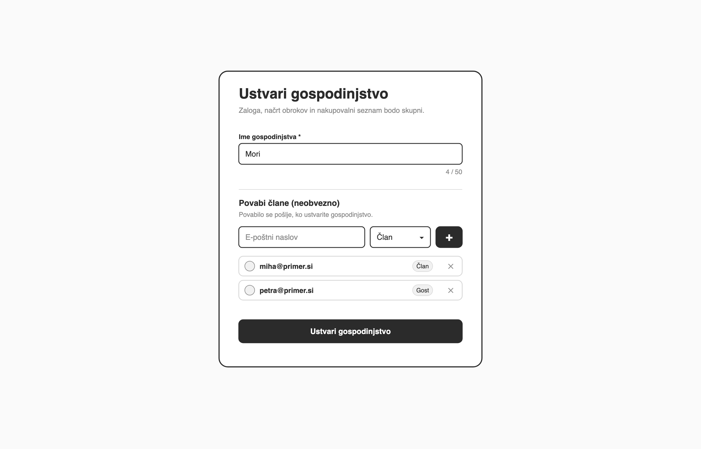

Zaslon za ustvarjanje novega gospodinjstva. Uporabnik vnese ime in s tem postane lastnik gospodinjstva. Že tukaj lahko vnese e-naslove sostanovalcev, jim izbere vlogo in jih z gumbom »+« doda na seznam. Povabila se pošljejo, ko je gospodinjstvo ustvarjeno.

## 02 – Zaloga – hladilnik

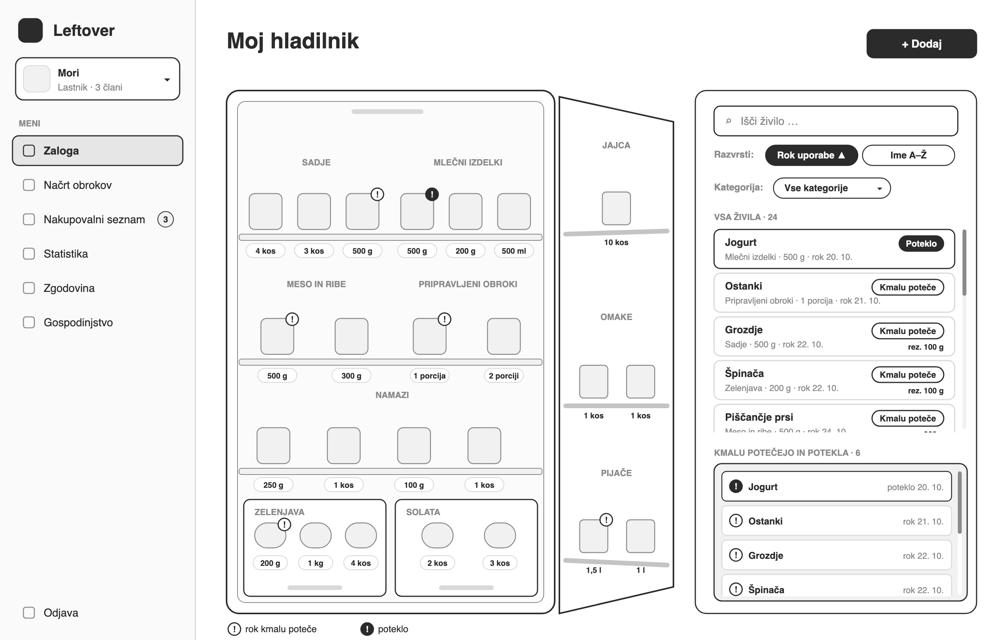

Glavni zaslon, kjer je zaloga prikazana kot odprt hladilnik. Živila so razporejena po kategorijah na policah, v predalih in na vratih, pri vsakem pa je napisana količina. Oznaka »!« pokaže živila, ki jim rok kmalu poteče ali je že potekel. Desno je seznam vseh živil, ki ga je mogoče pregledovati, iskati, razvrščati in filtrirati po kategoriji. Pod njim je manjši okvir z živili, ki kmalu potečejo ali so že potekla, in ima svoj drsnik.

## 03 – Zaloga – izbrana kategorija

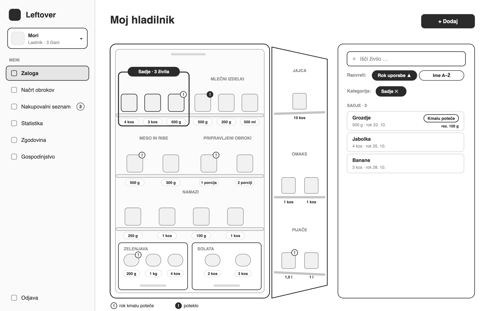

Ko uporabnik v hladilniku klikne kategorijo, na primer Sadje, se ta označi. V seznamu desno se samodejno vklopi filter, zato so prikazana samo živila te kategorije.

## 04 – Zaloga – podrobnosti živila

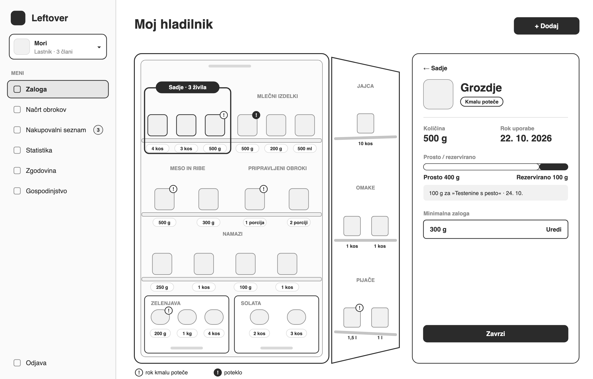

Podrobnosti izbranega živila s količino in rokom uporabe. Prikazano je, koliko živila je prostega in koliko ga je rezerviranega za načrtovane obroke. Uporabnik lahko nastavi minimalno zalogo in živilo zavrže.

## 05 – Zaloga – iskanje in razvrščanje

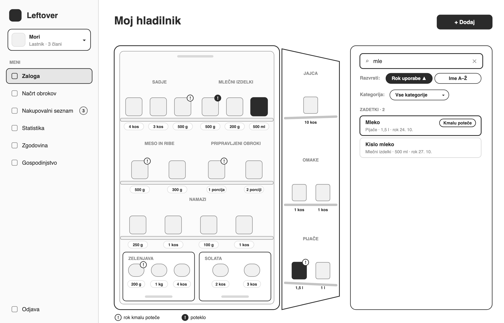

Iskanje po imenu, pri katerem se seznam desno sproti zoži na zadetke. Najdena živila so poudarjena tudi v hladilniku.

## 06 – Dodaj živilo

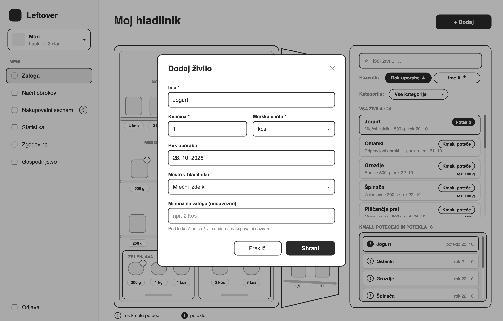

Okno za dodajanje novega živila. Obvezni so ime, količina in merska enota, poleg tega pa je mogoče vnesti rok uporabe, mesto v hladilniku in minimalno zalogo.

## 07 – Zavrzi živilo

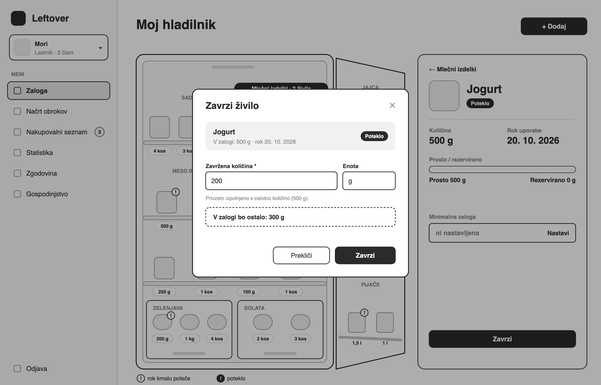

Okno za zavrženje živila, kjer je privzeto izpolnjena celotna količina. Okno se odpre s klikom »Zavrzi« v podrobnostih živila, ki ostanejo vidne desno. Uporabnik lahko zavrže samo del živila, preostanek pa ostane v zalogi.

## 08 – Načrt obrokov

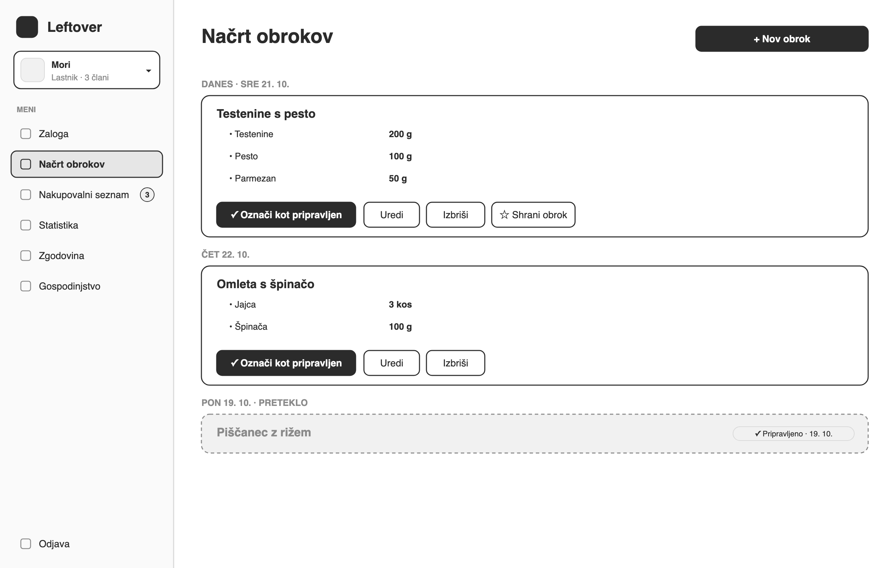

Načrtovani obroki, razvrščeni po datumu od najbližjega dneva naprej. Pri vsakem obroku so prikazane sestavine s količinami. Obrok je mogoče označiti kot pripravljen, urediti, izbrisati ali shraniti med shranjene obroke.

## 09 – Nov obrok

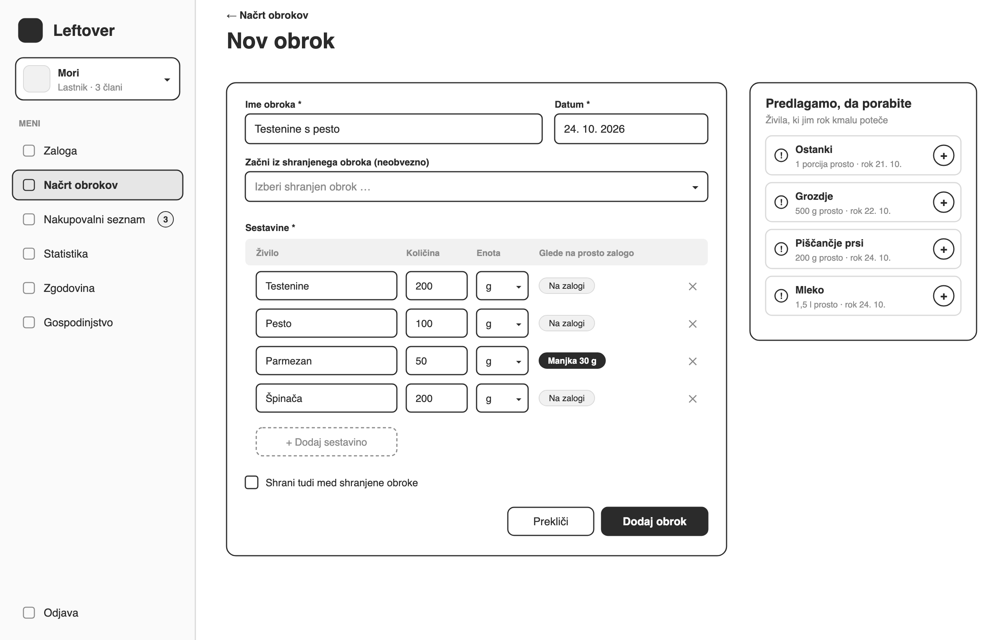

Obrazec za nov obrok z imenom, datumom in sestavinami. Pri vsaki sestavini je prikazano, ali je je v prosti zalogi dovolj. Desno so predlagana živila, ki jim kmalu poteče rok, obrok pa je mogoče začeti tudi iz shranjenega obroka.

## 10 – Označi obrok kot pripravljen

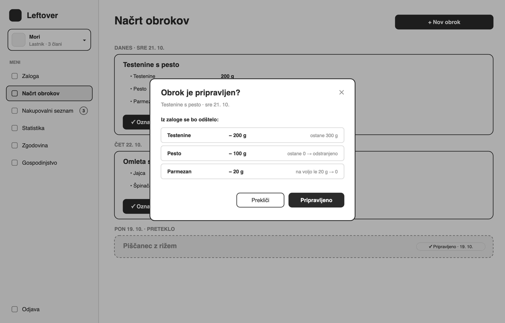

Okno, ki se odpre ob kliku »Označi kot pripravljen« v načrtu obrokov. Pokaže, koliko posamezne sestavine se bo odštelo od zaloge in katera živila bodo odstranjena. Šele po potrditvi se zaloga spremeni, obrok pa dobi oznako »Pripravljeno«.

## 11 – Nakupovalni seznam

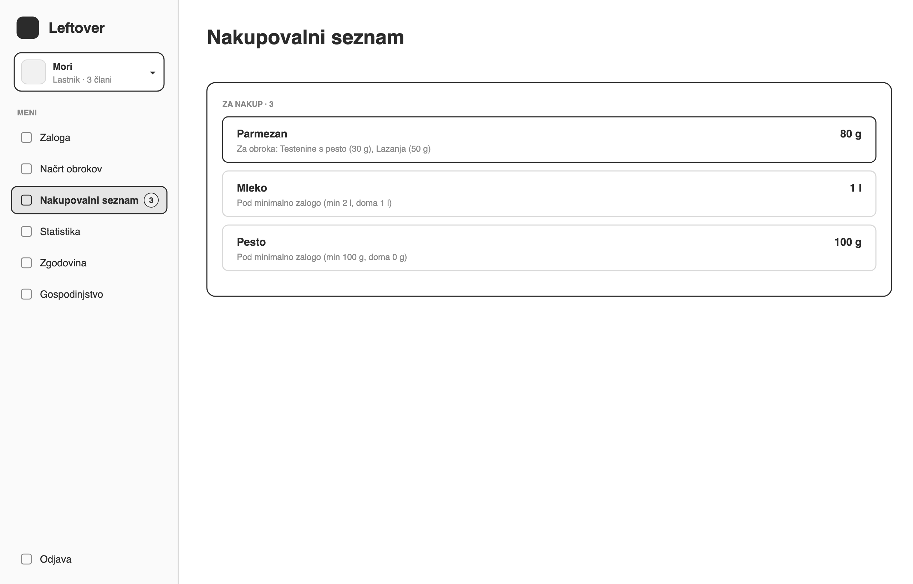

Nakupovalni seznam s postavkami, ki se dodajo samodejno. Pri vsaki postavki je napisano, zakaj je na seznamu, ali zaradi načrtovanega obroka ali ker je živilo padlo pod minimalno zalogo. Ista sestavina iz več obrokov je prikazana kot ena postavka s skupno količino.

## 12 – Gospodinjstvo

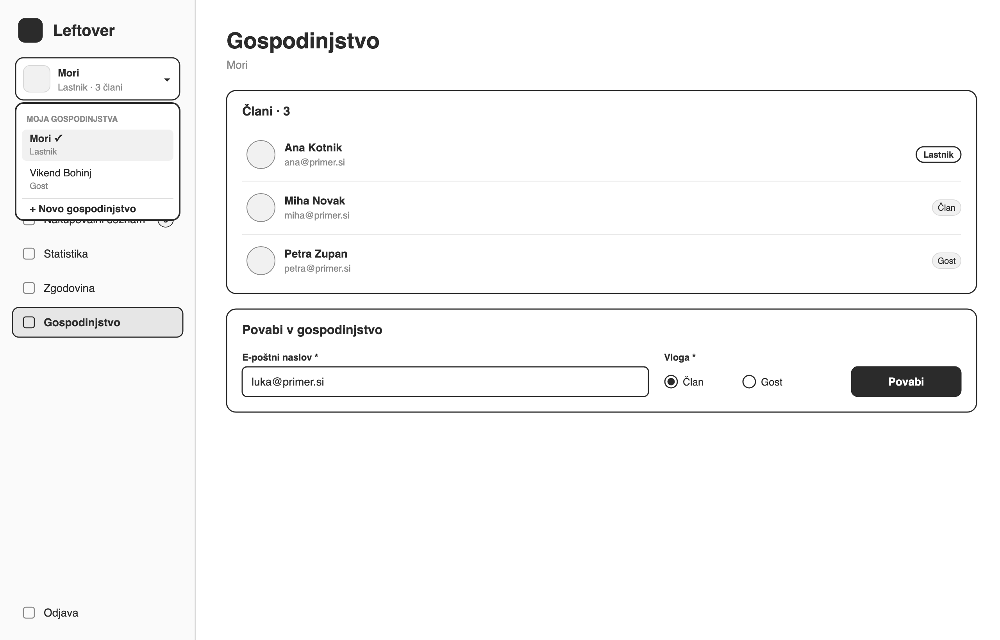

Upravljanje gospodinjstva s seznamom članov in njihovimi vlogami. Lastnik lahko povabi novega člana z e-naslovom in izbiro vloge član ali gost. V meniju levo uporabnik preklaplja med gospodinjstvi ali ustvari novo.

## 13 – Statistika

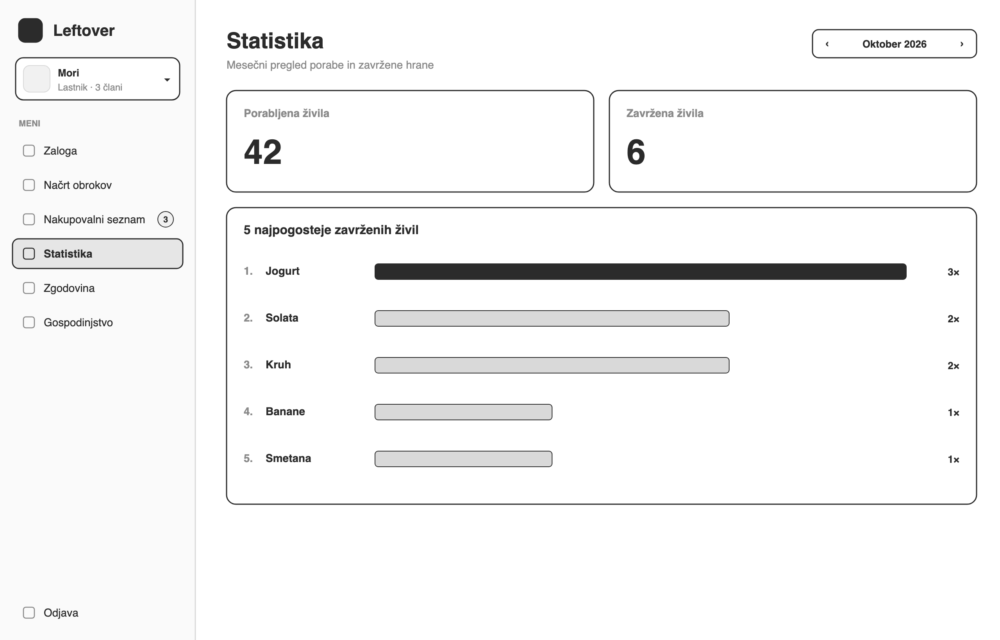

Mesečni pregled, ki prikaže število porabljenih in zavrženih živil. Spodaj je seznam petih najpogosteje zavrženih živil. Privzeto je izbran tekoči mesec, če zanj ni podatkov, se prikaže sporočilo.

## 14 – Zgodovina sprememb

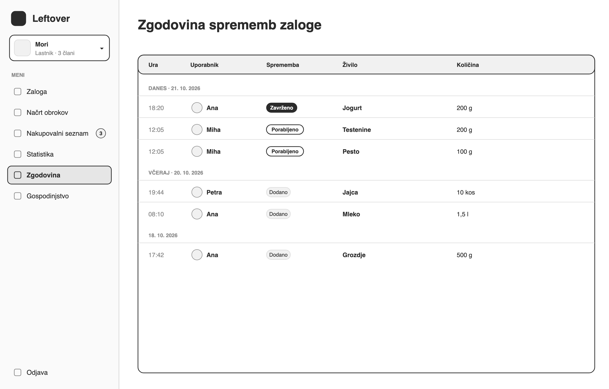

Zgodovina vseh sprememb zaloge, združena po dnevih in razvrščena od najnovejše naprej. Pri vsaki spremembi so ura, uporabnik, vrsta spremembe, živilo in količina. Zaslon je na voljo samo lastniku, zapisov pa ni mogoče urejati.
